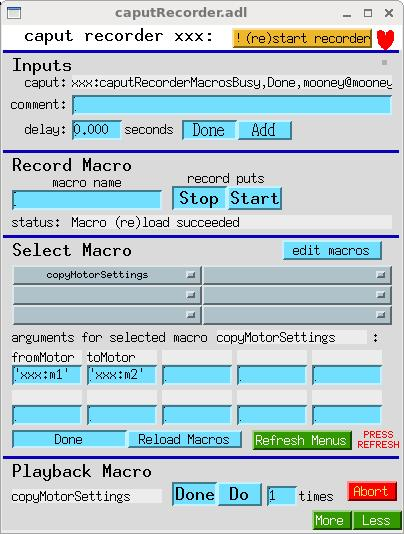
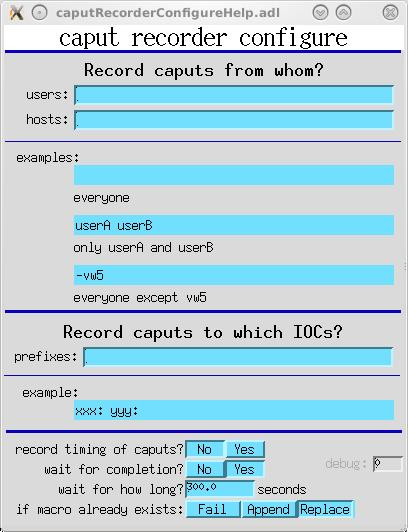
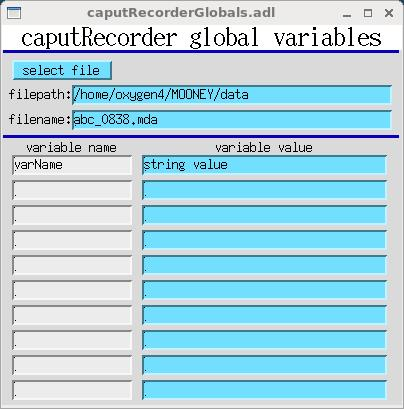

# User Guide
{: .no_toc}

## Table of contents
{: .no_toc .text-delta}

- TOC
{:toc}

## Requirements and Configuration

The caputRecorder database uses record types from the synApps
[busy](https://github.com/epics-modules/busy) and
[calc](https://github.com/epics-modules/calc) modules. The
workstation on which `caputRecorder.py` runs must have Python with
the [PyEpics](https://pypi.org/project/pyepics/) module installed.

EPICS IOCs that participate in caputRecorder, either by posting
the caputs they receive, or by hosting the database that functions
as caputRecorder's user interface, must be prepared as follows.
These are excerpts from the synApps xxx module, release R5-8,
which is already configured to use caputRecorder.

### 1. Add CAPUTRECORDER to the RELEASE file

Add the following to the IOC's `configure/RELEASE` file:

```
CAPUTRECORDER=$(SUPPORT)/caputRecorder-X-Y
```

### 2. Include the DBD file

Include `caputRecorder.dbd` in the IOC's `.dbd` file.

### 3. Link against the library

Link the IOC's code against the `caputRecorder` library.

### 4. Load the caputPoster database

```
dbLoadRecords("$(CAPUTRECORDER)/caputRecorderApp/Db/caputPoster.db","P=xxx:,N=300")
```

{: .note}
> `N` is the length of the longest caput-notification string
> (`pvname,value,user@host`) that will be sent to the recorder.

### 5. Load the caputRecorder database (optional)

If this IOC will host caputRecorder's user interface, load the
database `caputRecorder.db`:

```
dbLoadRecords("$(CAPUTRECORDER)/caputRecorderApp/Db/caputRecorder.db","P=xxx:,N=100")
```

{: .note}
> `N` is the length of the comment, users, hosts, and prefixes
> strings.

If you are using autosave, include `caputRecorder_settings.req`
in the IOC's `auto_settings.req` file:

```
file caputRecorder_settings.req P=xxx:,N=100
```

You must also add the following line to `save_restore.cmd`:

```
set_requestfile_path("$(CAPUTRECORDER)", "caputRecorderApp/Db")
```

### 6. Register the trap listener

Register caputRecorder's access-security trap listener. This
command must be executed **after** `iocInit`:

```
registerCaputRecorderTrapListener("xxx:caputRecorderCommand")
```

{: .note}
> `xxx:caputRecorderCommand` is the name of the PV to which
> caput-notification strings will be written.

### 7. Configure access security

Run EPICS access security with an access-security file that
specifies `TRAPWRITE` for the desired users and hosts:

```
iocsh
asSetFilename("$(TOP)/iocBoot/accessSecurity.acf")
exit
```

The file `accessSecurity.acf` might have the following content:

```
HAG(workstation) {mooneylinux.aps.anl.gov}
UAG(user) {mooney}
ASG(DEFAULT) {
    RULE(1,READ)
    RULE(1,WRITE,TRAPWRITE) {
        HAG(workstation)
        UAG(user)
    }
    RULE(1,WRITE)
}
```

This file grants write permission to anybody on any host, and
specifies that `TRAPWRITE` is in effect only for user *mooney*
on workstation *mooneylinux*. For the purposes of caputRecorder,
you probably do not want `TRAPWRITE` in effect for caputs from an
IOC, but do want it for caputs from channel-access clients, such
as MEDM, that are not in an IOC.

{: .important}
> The order in which rules occur in the file matters for
> `TRAPWRITE`. If `RULE(1,WRITE)` were encountered before
> `RULE(1,WRITE,TRAPWRITE)`, `TRAPWRITE` would not be in effect
> for anybody, because everybody is covered by `RULE(1,WRITE)`.

If you cannot or do not want to select users and hosts using
access-security rules, you can specify `TRAPWRITE` for all, and
select users and hosts with caputRecorder's user interface. The
simplest possible access-security file that will work for
caputRecorder is:

```
ASG(DEFAULT) {
    RULE(1,WRITE,TRAPWRITE)
}
```

### 8. Set environment variables

The following environment variables must be set before running
MEDM (caQtDM, etc.):

**START\_PUTRECORDER** -- The path to a script that starts
`caputRecorder.py`. This will be used by the "!(re)start
recorder" button described below. There is a sample script at
`caputRecorder/example_start_putrecorder`.

{: .important}
> Only one copy of `caputRecorder.py` (for a given user-interface
> database) should be running at a time. `caputRecorder.py`
> detects the launch of a new copy that uses the same control PVs,
> and exits.

**MACROS\_PY** -- The path to the macros file, in which caputs
will be recorded. An example file is at
`caputRecorder/caputRecorderApp/op/python/example_macros.py`.

**EDITOR** -- The command that invokes your preferred editor,
which will be used for the "edit macros" button described below.

## How to Use


caputRecorder.adl

Referring to the `caputRecorder.adl` display above, from top to
bottom:

- The button labelled "!(re)start recorder" starts or restarts
  the Python program `caputRecorder.py`.

- The heart symbol to the right of the "!(re)start recorder"
  button blinks while `caputRecorder.py` is running and
  responsive to its control PVs.

### Inputs

- The text-monitor field labelled "caput:" displays the PV name
  and value most recently written to the IOC. This field is
  written to by the access-security trap listener, and is updated
  whether or not a Python macro is being recorded.

- The text-entry field labelled "comment:" allows you to add
  comments to the macro being recorded. This field is monitored
  only while a macro is being recorded.

- The text-entry field labelled "delay" specifies the time delay
  in seconds of the delay command that will be added to the macro
  being recorded when you press the "Add" button. The actual
  Python code for this command will be something like
  `time.sleep(1.200)`. After `caputRecorder.py` has written the
  delay command, it will press the "Done" button.

### Record Macro

- The text-entry field labelled "macro name" specifies the name
  of the macro (Python function) you will record.

  By default, you are not permitted to use a macro name that
  already exists in `macros.py`. See [Record Options](#record-options)
  for alternatives.

  The macro name must start with a letter, and must consist of
  letters, digits, and underscores. caputRecorder will enforce
  this by prepending "a" and/or replacing offending characters
  with underscores. The macro name will be truncated to 25
  characters; this limit is set by the length of an mbboRecord's
  menu-string field.

- The choice button labelled "record puts" is used to start and
  stop recording. While recording, you can write to EPICS PVs
  via any EPICS client, and you can also execute any macro that
  has already been recorded.

- If you execute macro **A** while recording macro **B**, and
  then stop recording while macro **A** is still executing,
  caputRecorder will make you wait for macro **A** to finish
  before allowing you to start a new recording of another macro.

- When you execute macro **A** while recording macro **B**,
  caputRecorder will suppress recording of the caputs that result
  from the execution of macro **A**, and will simply record a
  function call to macro **A**.

### Select Macro

- The button labelled "edit macros" invokes the command named by
  the environment variable `EDITOR` on the file `macros.py`.

- The gray boxes are menus, which will contain the names of
  recorded macros, and they are the means by which a macro can be
  selected manually for playback. Currently caputRecorder
  supports six menus, each of which can hold 16 macro names.

- The text-monitor and text-entry fields under the "arguments for
  selected macro" label are the names and default values of the
  arguments, if any, of the selected macro. As recorded, macros
  have no arguments, but you can edit the Python code to add up
  to 20 arguments. Only ten arguments are displayed by
  `caputRecorder.adl`; `caputRecorderExecute.adl` (called up
  from the "Less" menu) displays all 20. If you do add
  arguments, you must use the `name=value` syntax for defining
  macro arguments. For example, here is a macro definition with
  one string argument and three numeric arguments:

  ```python
  def motorscan(motor="m1", start=0, end=1, npts=11):
  ```

- Normally, you should not have to press the "Reload Macros"
  button, because caputRecorder reloads automatically after a
  new macro has been recorded. However, if you edit `macros.py`
  manually, you must press "Reload Macros" to tell caputRecorder
  to reread the file. If you deleted a function definition from
  `macros.py`, reloading is not sufficient; you must restart
  caputRecorder using the "!(re)start recorder" button.

- The "Refresh Menus" button must be pressed whenever menus have
  changed. This happens when macro recording is done, after you
  press the "!(re)start recorder" button, after you press the
  "Reload Menus" button, and after the controlling IOC reboots.
  caputRecorder will tell you when menus need to be refreshed by
  showing the blinking text "PRESS REFRESH". This blinking text
  will go away when any instance of `caputRecorder.adl`, or
  `caputRecorder_small.adl`, is refreshed.

### Playback Macro

- The text-monitor field contains the name of the selected macro.
  To play it back (to cause Python to execute it) press the "Do"
  button. When the macro has finished, the "Do" button will
  return to the "Done" state. If you want to execute the macro
  repeatedly, enter the number of times in the field labelled
  "times."

- The "Abort" button is intended to stop an executing macro, and
  also to do any other abort-related work specified in the
  function named `_abort` in `macros.py`. The supplied
  `example_macros.py` defines an abort function that aborts
  scans, halts motors, and stops the scaler named "scaler1".

- Any EPICS client or record can trigger macro execution by
  writing a macro name to `$(P)caputRecorderMacro`, optionally
  writing to any argument fields, and then writing "Do" (or the
  number 1) to `$(P)caputRecorderExecuteMacro`. The client
  **must** wait for completion after both writes, to ensure that
  arguments have been updated before writing to them or executing
  the macro, and to wait for macro execution to finish.

## Selecting What Gets Recorded

You probably do not want to record all caputs that happen among
your IOCs and clients, but only those done by users. One way of
filtering was shown above in
[Configure access security](#7-configure-access-security).
User-specified filtering is easier, and can be done at run time
with caputRecorder's user interface.


caputRecorderConfigure.adl

1. You can choose which users' caputs will be recorded by
   specifying usernames to `caputRecorderUsers`. (See "Record
   caputs from whom?" in the figure above.) To disable recording
   from a specific user, put a minus sign in front of the
   username.

2. You can choose which hosts' caputs will be recorded by
   specifying hostnames to `caputRecorderHosts`. (See "Record
   caputs from whom?" in the figure above.) Only the first
   element of a host name need be specified. For example,
   `mooneylinux.aps.anl.gov` is used as `mooneylinux`.

3. You can choose which IOCs caputRecorder monitors, by
   specifying prefixes to `caputRecorderPrefixes`. (See "Record
   caputs to which IOCs?" in the figure above.) Unlike user and
   host choices, this choice does not take effect while a macro
   is being recorded. Also unlike user and host choices, this
   choice is not about the sender of a caput, but about the
   recipient.

   On startup, caputRecorder monitors the IOCs whose prefixes
   are specified on the command line. If `caputRecorderPrefixes`
   is not empty, it will override the initial list of IOCs.

4. Caputs within an IOC will never be recorded, because they do
   not go through access security.

## Record Options

### Timing

The timing of caputs will, in general, be different on replay
than when recorded, but you can tell caputRecorder to try to
reproduce the timing. If you select "Yes" for "record timing of
caputs?" (see diagram above), caputRecorder will insert delays
between caput commands. You can change this setting while
recording. If caputRecorder waits for completion, the required
delay time could be negative, in which case caputRecorder will
insert no delay.

### Wait for Completion

You can choose whether or not caputRecorder will wait for
completion after executing recorded caputs, by setting "wait for
completion?" (see diagram above). This affects the Python code
written while recording, and is not an execute-time choice. You
can change this setting while recording.

If you tell caputRecorder to wait for completion, you can tell it
for how long to wait, using the text-entry field labelled "wait
for how long?". You can change this time while recording.

### Behavior if Macro Name Already Exists

If you attempt to record a macro whose name is already defined in
`macros.py`, caputRecorder will do one of three things, depending
on the setting of the "if macro already exists:" switch:

- **Fail** -- Refuse to start recording, and set the Stop/Start
  switch back to Stop.

- **Append** -- Move the macro to the end of the file, and begin
  appending commands to it.

- **Replace** -- Delete the existing macro, and begin a new macro
  with that name. In this case, caputRecorder will write a backup
  copy of `macros.py`, named `macros.py_yymmdd-HHMMSS`, where
  `yy...` is the current date and time.

## Global Variables

caputRecorder maintains a small number of EPICS PVs that can be
used as global variables in any macro. The EPICS display for these
variables is shown below.


caputRecorderGlobals.adl

If wxPython is available, the variables `filepath` and `filename`
are supported by a file requester. If wxPython is not available,
the variables can still be used, but values must be entered
manually.

The rest of the variables are generic: both a variable name and
its string value can be specified. A macro can retrieve global
variables by calling the function `_getGlobals(prefix='xxx:')`
(imported from caputRecorder). `_getGlobals()` returns a Python
dictionary with global variable names and values. For the display
above, the following dictionary would be returned:

```python
{'varName': 'string value',
 'filename': 'abc_0838.mda',
 'filepath': '/home/oxygen4/MOONEY/data'}
```

Here is sample code demonstrating the use of global variables in
a macro:

```python
def testGlobals():
    g = _getGlobals("xxx:")
    print "globals=%s" % g

    filename = g['filename']
    print "filename = ", filename
```

## Deployment

### Full Deployment

This section walks through adding caputRecorder to an existing
EPICS application, including the full user interface and the
Python recorder program.

#### IOC Configuration

1. Edit `configure/RELEASE` and add:

   ```
   CAPUTRECORDER=$(SUPPORT)/caputRecorder-X-Y
   ```

2. Edit the application's `src/Makefile` and add (using your
   application name in place of `myApp`):

   ```makefile
   ifdef CAPUTRECORDER
       myApp_Common_DBD += caputRecorder.dbd
       myApp_Common_LIBS += caputRecorder
   endif
   ```

3. Rebuild:

   ```bash
   make rebuild
   ```

4. Create an access-security file at
   `$(TOP)/iocBoot/accessSecurity.acf`. See
   [Configure access security](#7-configure-access-security) for
   examples.

5. Edit `st.cmd` and add:

   ```
   # Access Security
   iocsh
   asSetFilename("$(TOP)/iocBoot/accessSecurity.acf")
   exit

   # caputRecorder
   dbLoadRecords("$(CAPUTRECORDER)/caputRecorderApp/Db/caputPoster.db","P=myApp:,N=300")
   dbLoadRecords("$(CAPUTRECORDER)/caputRecorderApp/Db/caputRecorder.db","P=myApp:,N=100")
   ...
   iocInit
   ...
   registerCaputRecorderTrapListener("myApp:caputRecorderCommand")
   ```

6. Edit `save_restore.cmd` and add:

   ```
   set_requestfile_path("$(CAPUTRECORDER)", "caputRecorderApp/Db")
   ```

7. Edit `auto_settings.req` and add:

   ```
   file caputRecorder_settings.req P=myApp:,N=300
   ```

{: .note}
> For soft IOCs, the `iocsh` and `exit` commands around
> `asSetFilename` are not needed.

#### Workstation Setup

1. Copy the start script:

   ```bash
   cp $CAPUTRECORDER/example_start_putrecorder start_putrecorder
   ```

2. Edit `start_putrecorder` and fix the following lines to match
   your application:

   ```bash
   EPICS_APP=/path/to/your/application
   MACROS_PY_DIR=${EPICS_APP}/myAppApp/op/python
   ```

3. Set the following environment variables in your startup
   scripts (e.g., `start_epics` or `setup_epics_common`):

   - `START_PUTRECORDER` -- path to `start_putrecorder`
   - `EDITOR` -- your preferred text editor for Python files

4. Add caputRecorder's display directory to `EPICS_DISPLAY_PATH`:

   ```bash
   export EPICS_DISPLAY_PATH=$EPICS_DISPLAY_PATH:$CAPUTRECORDER/caputRecorderApp/op/adl
   ```

5. Create the macros file directory and initialize the macros
   file:

   ```bash
   mkdir myAppApp/op/python
   cp $CAPUTRECORDER/caputRecorderApp/op/python/example_macros.py myAppApp/op/python/macros_myApp.py
   chmod a+w myAppApp/op/python/macros_myApp.py
   ```

   Edit the new macros file: delete everything but the `_abort`
   function and the blank line after it, then edit `_abort` so it
   does what the user wants when a macro is aborted.

6. Add a caputRecorder button to your MEDM display:

   ```
   label="caputRecorder", name="caputRecorder.adl", args="p=myApp:"
   ```

### Minimal Deployment (caputPoster Only)

If an IOC only needs to post its caputs to a caputRecorder
running elsewhere (without hosting the full user interface), use
this minimal configuration.

1. Edit `configure/RELEASE` and add:

   ```
   CAPUTRECORDER=$(SUPPORT)/caputRecorder-X-Y
   ```

2. Edit the application's `src/Makefile`:

   ```makefile
   ifdef CAPUTRECORDER
       myApp_Common_DBD += caputRecorder.dbd
       myApp_Common_LIBS += caputRecorder
   endif
   ```

3. Rebuild:

   ```bash
   make rebuild
   ```

4. Create an access-security file at
   `$(TOP)/iocBoot/accessSecurity.acf`:

   ```
   ASG(DEFAULT) {
       RULE(1,WRITE,TRAPWRITE)
   }
   ```

5. Edit `st.cmd` and add:

   ```
   iocsh
   asSetFilename("$(TOP)/iocBoot/accessSecurity.acf")
   exit

   dbLoadRecords("$(CAPUTRECORDER)/caputRecorderApp/Db/caputPoster.db","P=myApp:,N=300")
   ...
   iocInit
   ...
   registerCaputRecorderTrapListener("myApp:caputRecorderCommand")
   ```

## Discussion

- caputRecorder "reads" the `macros.py` file by importing it:

  ```python
  import macros
  ```

  After `macros.py` has been changed, caputRecorder "rereads" it
  by reloading:

  ```python
  reload(macros)
  ```

  Reload will overwrite objects in the live macros module with
  values from `macros.py`, but it will not delete any objects. If
  you delete a function definition or a global variable from
  `macros.py`, reloading will not remove it from the live copy of
  the macros module; you have to restart Python, which you can do
  by pressing the "!(re)start recorder" button.

- caputRecorder records a caput with the following Python code:

  ```python
  epics.caput("xxx:scan1.P1PV", "xxx:m2.VAL", wait=True, timeout=1000000.0)
  ```

  This code will request a completion callback from EPICS, and
  will wait for the callback to arrive. Currently, it is not an
  error for a macro to timeout while waiting for a callback.
  Python will simply move on to the next command and execute it.
  Currently, caputRecorder does not take advantage of PyEpics'
  ability to execute several commands and then wait for all to
  complete (that is, the `use_complete` option of the PV class's
  `put()` method).

- [caPutLog](http://www-csr.bessy.de/control/SoftDist/caPutLog)
  can also trap caputs and write them to a PV. A
  proof-of-principle implementation of caputRecorder used caPutLog
  3.4 to do this, but it did not handle long strings.

- In EPICS 3.14.12.4 and earlier, and in versions of 3.15
  earlier than 3.15.2, access security did not provide the data
  from a caput to the asTrapListener, so caputRecorder used
  `dbGetField()` to get the data after it had been written. This
  was acceptable for most PVs, but some PVs (for example, the
  tweak fields of a motor record) have their values changed
  immediately after being written, and caputRecorder was getting
  the final value, rather than the value the user actually wrote.
  Andrew Johnson fixed this by providing data to the
  asTrapListener, and caputRecorder R1-4 and later will use this
  capability if it is present.

- caputRecorder R1-4 monitors the connection status of one of its
  PVs, and exits if that PV remains disconnected for more than 10
  seconds.

- The EDM display-file translation failed at the adl file's
  "shell command", so those items were deleted from the EDM
  displays.

- You can run more than one instance of caputRecorder in an IOC
  (but only one copy per IOC of `caputPoster.db` is supported).
  To run two instances of caputRecorder, you must give them
  different prefixes:

  ```
  dbLoadRecords("$(CAPUTRECORDER)/caputRecorderApp/Db/caputPoster.db","P=xxx:,N=300")
  dbLoadRecords("$(CAPUTRECORDER)/caputRecorderApp/Db/caputRecorder.db","P=xxx:,N=100")
  dbLoadRecords("$(CAPUTRECORDER)/caputRecorderApp/Db/caputRecorder.db","P=xxxA:,N=100")
  ...
  iocInit
  ...
  registerCaputRecorderTrapListener('xxx:caputRecorderCommand')
  ```

  `start_putRecorder` must specify a different name for
  `macros.py` for the two instances. The
  `example_start_putRecorder` script does this as follows:

  ```bash
  MACROS_PY=${MACROS_PY_DIR}/"macros_"${PREFIX}.py
  # start caputRecorder.py
  $COMMAND ${PREFIX} ${MACROS_PY}&
  ```

  Also, you must tell the second copy to look at the one
  installed copy of `caputPoster.db` (that is, the
  `xxx:caputRecorderCommand` PV) by specifying the prefix in the
  "prefixes:" string.
