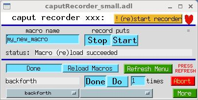

# caputRecorder
{: .no_toc}

## Table of contents
{: .no_toc .text-delta}

- TOC
{:toc}


caputRecorder\_small.adl

## Overview

caputRecorder supports the recording and playback of sequences of
caputs. It records each caput as a Python command, and a sequence
of caputs as a Python function -- also called here a **macro**.
caputRecorder can also serve as a simple user interface for
delivering canned Python functions to end users. caputRecorder
communicates with users via an EPICS database, so it allows any
EPICS record or channel-access client to record and run Python
functions, and to wait for them to complete.

A *caput* is short for "Channel Access put". When you press a
button, or make a menu selection, in an MEDM (or other display
manager) display, you are doing a caput. Any program that writes
to EPICS PVs does so by doing caputs.

caputRecorder also supports generalizing recorded macros with
arguments. This requires manual editing of Python code. It
provides a user interface through which macro arguments are
displayed with default values that can be changed via channel
access.

{: .note}
> This version of caputRecorder is known to work with Python 2.7.
> It probably will not work with Python 3.

caputRecorder is intended to meet the following kinds of needs:

- Automate measurements involving sequences of steps that users
  know how to do manually, but for which no software has been
  written. If users can do a measurement step manually while
  the recorder is on, they will in effect have written software
  to automate that step, and they can then combine several such
  steps as needed to perform a particular instance of the
  measurement type.

- Improve communication between users and the software
  developers who support them. Rather than describing needed
  software in general terms, or laboriously listing the required
  actions in the required order, a user can simply record them,
  with comments for any actions outside of EPICS, and send the
  developer the Python code.

- Assist in troubleshooting, by recording exact sequences of
  caputs that do and do not reproduce a problem.

- Automate testing, by recording sequences of caputs that succeed
  with the current version of some software, and playing them
  back to verify that they also succeed with the new version.

- Show someone how to operate a complicated device by operating
  it yourself, while recording, and emailing them the Python
  code.

- Record everything a user does. (But
  [caPutLog](http://www-csr.bessy.de/control/SoftDist/caPutLog)
  is a much better tool for this purpose.)

## How It Works

EPICS access security has the ability to call a user function
whenever a caput that meets certain criteria is received by an IOC.
The function is called an *access-security trap listener*, and
caputRecorder provides one which writes a caput-notification string
of the form `pvname,value,user@host` to an EPICS PV whenever an
eligible caput is received by the IOC.

caputRecorder provides an EPICS database that contains the EPICS
PV mentioned above, and other PVs that function as caputRecorder's
user interface. The user-interface PVs are monitored by the Python
program `caputRecorder.py`, and direct its operation. When
`caputRecorder.py` is given a macro name and told to record, it
begins monitoring the caput-notification PVs of specified IOCs, and
writes Python commands corresponding to each notification into the
Python program file `macros.py`. Here is what a typical command
looks like:

```python
epics.caput("xxx:scan1.P1PV", "xxx:m2.VAL", wait=True, timeout=1000000.0)
```

This writes the string `xxx:m2.VAL` to `xxx:scan1.P1PV`, and waits
for any EPICS processing that might result from the command to
complete.

`caputRecorder.py` also inspects the file `macros.py` and writes
the names of macros in the file to a set of EPICS menus (that is,
to the menu-string fields of mbbo records). A user can select a
macro name from those menus, and tell caputRecorder to execute
that macro.

Thus, each IOC is responsible for telling caputRecorder that it
received a caput, and one IOC also hosts the database through
which the user tells caputRecorder what to do.

## Dependencies

caputRecorder requires the following:

- [EPICS base](https://github.com/epics-base/epics-base)
  (3.14.12 or later, including 3.15+ and 7.0+)
- [busy](https://github.com/epics-modules/busy)
- [calc](https://github.com/epics-modules/calc) (for the sseq
  record)
- [PyEpics](https://pypi.org/project/pyepics/) (Python 2.7) --
  on the workstation running `caputRecorder.py`
- Optional: [wxPython](https://wxpython.org/) -- for the file
  selector dialog in global variables
